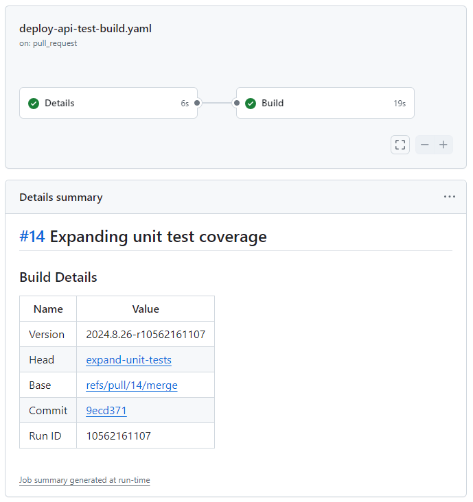

# build-details action

Creates a summary of your build with version and pull request information.



## Inputs

### `version`

**Required** The symantic version of the build.

### `token`

**Required** The GitHub token to use for authentication.

## Behavior

1. Writes a job summary with the pull request and build details (version, head, base, commit, run ID).
2. Uploads a `build-details` artifact containing `build-details.json`.
3. Finds the check run of the job running the action and sets its output text to `PR_DEPLOY_BUILD`, with the title `Build details` and the summary `Version: <version>`. This marks the check as a PR Deploy build.

The job is matched as the in-progress job of the current run attempt on this runner (`RUNNER_NAME`). If no matching job or check run is found, or the token can't update it, the action fails.

## Permissions

The token needs these permissions:

```yaml
permissions:
  contents: read
  pull-requests: read
  actions: read  # list the run's jobs to find the current check run
  checks: write  # set the check run output text
```

## Example

```yaml
- name: Build details
  uses: greggbjensen/prdeploy/.github/actions/build-details@main
  with:
    version: '1.0.0-beta0005'
    token: ${{ secrets.GITHUB_TOKEN }}
```

## Development

```bash
npm install
npm test          # Jest unit tests in __tests__/
npm run lint
npm run build     # tsc to lib/
npm run package   # ncc bundle to dist/ (commit dist/, action.yaml runs dist/index.js)
```
