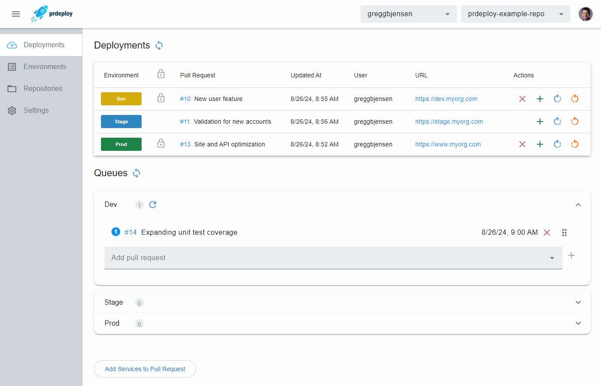
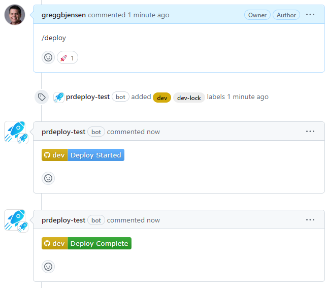

# prdeploy

GitHub App that allows the entire build-deploy lifecycle to happen within a feature branch.  If any problems are found in the deployment, a new commit is done and rolled through without needing multiple PRs.

# Documentation

Review the prdeploy documentation at https://prdeploy.readthedocs.io.

## Repository Guides

- [prdeploy API](./prdeploy-api/README.md)
- [prdeploy web application](./prdeploy-app/README.md)
- [Local development scripts](./scripts/README.md)
- GitHub Actions:
  - [build-details](./.github/actions/build-details/README.md)
  - [date-version](./.github/actions/date-version/README.md)
  - [deploy-tags](./.github/actions/deploy-tags/README.md)
  - [get-build-info](./.github/actions/get-build-info/README.md)

## Bruno API Client

The version-controlled Bruno OpenCollection YAML collection is in [`bruno/`](./bruno/opencollection.yml). Download and install the Bruno desktop client from [usebruno.com/downloads](https://www.usebruno.com/downloads).

To use it locally:

1. Start the API following the [API development instructions](./prdeploy-api/README.md#development). The API listens on `http://localhost:4302`.
2. Copy `bruno/environments/local.example.yml` to `bruno/environments/local.yml`, then open the repository's `bruno/` folder as a collection in Bruno and select the **Local** environment.
3. Set the local environment's `jwt`, `owner`, and `repo` values as needed. The local environment file is git-ignored; keep tokens and other credentials private.
4. Choose a request under **REST endpoints** or **GraphQL operations** and send it. GraphQL requests need a valid prdeploy JWT. OAuth code exchange needs a fresh, single-use authorization code.

The API's OpenAPI document is available at [http://localhost:4302/openapi/v1.json](http://localhost:4302/openapi/v1.json) while the API is running in Development. REST request documentation links directly to the corresponding OpenAPI operation. GraphQL requests link to their source operation files. Review mutation inputs carefully; deployments, settings, and queue mutations change state.

# prdeploy portal

Use the prdeploy portal dashboard to overview releases and deployment queues and act on them.

# Comment Commands

Post comment commands to manage your deployments without leaving your pull request.

| Command                                              | Description                                                                                                                         |
| ---------------------------------------------------- | ----------------------------------------------------------------------------------------------------------------------------------- |
| `/deploy` `/deploy dev`                           | Deploy to first available dev environment or get added to queue.                                                                    |
| `/deploy stage`                                      | Deploy to stage environment or get added to queue.                                                                                  |
| `/deploy prod`                                       | Deploy to prod environment or get added to queue.                                                                                   |
| `/deploy dev2 --force` `/deploy stage --force`    | Override deploy to a specific dev, stage, or prod environment and skip the queue.                                                   |
| `/deploy stage --retain` `/deploy prod --retain`  | Promote pull request to next environment, but retain the lock on the current one as well. Can also be used with --force.            |
| `/free`                                              | Remove lock on all deployed environments for others to use it.                                                                      |
| `/free stage`                                        | Remove lock on specified environment only for others to use it.                                                                     |
| `/rollback`                                          | Rollback current locked environment to the previous version. If there are multiple environments locked, you must specify which one. |
| `/rollback prod` `/rollback stage`                | Rollback a specific environment to the previous version. You must have a lock on an environment to roll it back.                    |
| `/rollback prod 2`                                   | Rollback a specific environment multiple versions in history.                                                                       |
| `/add mydomain-api-service mydomain-app-main`        | Add services to be built and deployed with the pull request that have no code changes.                                              |

## Deployment Practices

1. Each pull request should be deployed as ready in the CD workflow.
2. Only once deployed and verified the pull request should be merged to main.
3. This application is deployed to a kubernetes cluster using the helm chart.

# Contributing

1. For API and webhooks development and debugging, see [prdeploy-api Development](/prdeploy-api/README.md#development).
2. For web application setup and development, see the [prdeploy web application guide](./prdeploy-app/README.md).
