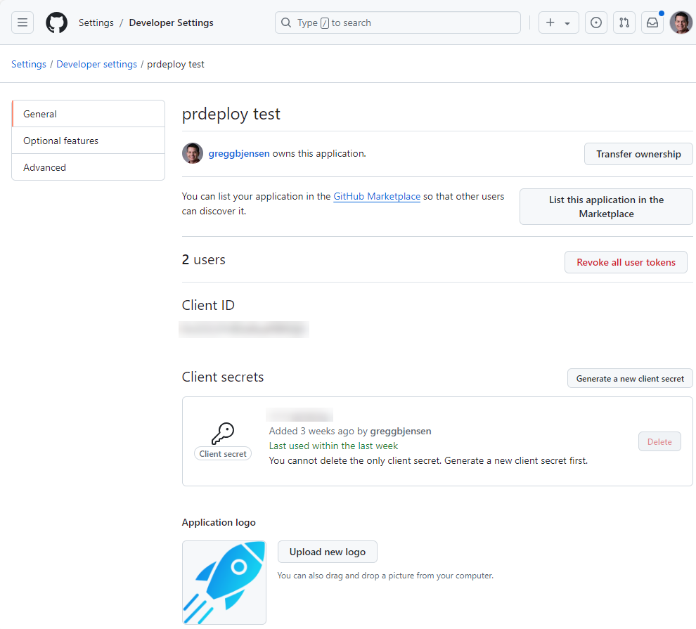

For authorization of the portal to view deployments, we need to create an GitHub OAuth App.

## 1. Create GitHub OAuth App


{: style="margin: 30px 0 60px 0; box-shadow: rgba(0, 0, 0, 0.2) 0px 3px 3px -2px, rgba(0, 0, 0, 0.14) 0px 3px 4px 0px, rgba(0, 0, 0, 0.12) 0px 1px 8px 0px;"}

1. Still on your organization page, expand **Developer settings** on the left nav and choose **OAuth Apps**.
2. Click **New OAuth App**.
3. Enter the following information:

| Field                      | Value                                                                       |
| -------------------------- | --------------------------------------------------------------------------- |
| Application name           | prdeploy myorg                                                              |
| Homepage URL               | https://prdeploy.myorg.com                                                  |
| Description                | Allows the entire build-deploy lifecycle to happen within a feature branch. |
| Authorization callback URL | https://prdeploy.myorg.com/login/callback                                   |

4. Click on **Register application**.

## 2. Application configuration

1. Click **Generate a new client secret** and copy the following for your notes:
    * The new Client secret
    * Client ID

2. Under **Application logo** click on **Upload a logo...**.
3. Download and select the file from `https://github.com/greggbjensen/prdeploy/blob/main/docs/assets/images/logo-128x128.png`.
4. Click **Update application**.

## 3. Approve the app for organizations with access restrictions

If an organization listed in `GitHubAuth__AllowedOrganizations` has **OAuth App access restrictions** enabled, GitHub blocks prdeploy from reading that organization's membership. Users who belong only to that organization are then rejected at sign-in, and the API logs `the <org> organization has enabled OAuth App access restrictions`.

An organization owner must approve the app:

1. Go to `https://github.com/organizations/<org>/settings/oauth_application_policy`.
2. Find the OAuth app you created above. If it is not listed, ask a member to click **Request** next to the organization on the app's authorization page after signing in.
3. Click **Review**, then **Grant access**.

Alternatively, remove the restrictions from the same page. Repeat for each allowed organization that has them enabled. Members must sign in again after approval.

## 4. Application configuration (local development)

1. Create **prdeploy-api/src/PrDeploy.Api/appsettings.Development.yaml**. It is gitignored, so your local secrets are not committed.
2. Fill in the following:

    ```yaml
    GitHubAuth:
      ClientId: "<Client ID from 2.1 above>"
      ClientSecret: "<Client Secret from 2.1 above>"
      AllowedOrganizations: # Organizations whose members may sign in.
        - <organization>
    GitHubApp:
      AppId: "<From Settings General, in About section>"
      PrivateKeyPath: "../../gh-app-key-local.pem"
      WebhookSecret: "<Value generated by the command below>"
    Jwt:
      Key: "<Value generated by the command below>"
      TokenEncryptionKey: "<Value generated by the command below>"
    ```

    `node -e "console.log(require('crypto').randomBytes(64).toString('base64'));"`

    `GitHubApp:WebhookSecret` must exactly match the **Webhook secret** set on the GitHub App, or every delivery is rejected with an invalid signature. `.env` files are not read; environment variables (for example `GitHubApp__WebhookSecret`) still override the YAML files.

[Next step - 3. Slack App](./3-slack-app.md)
